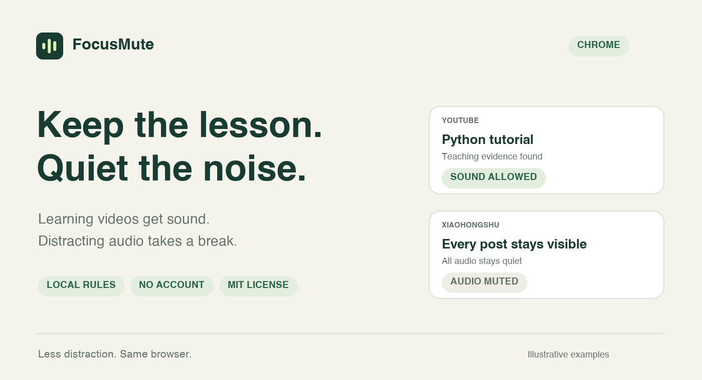
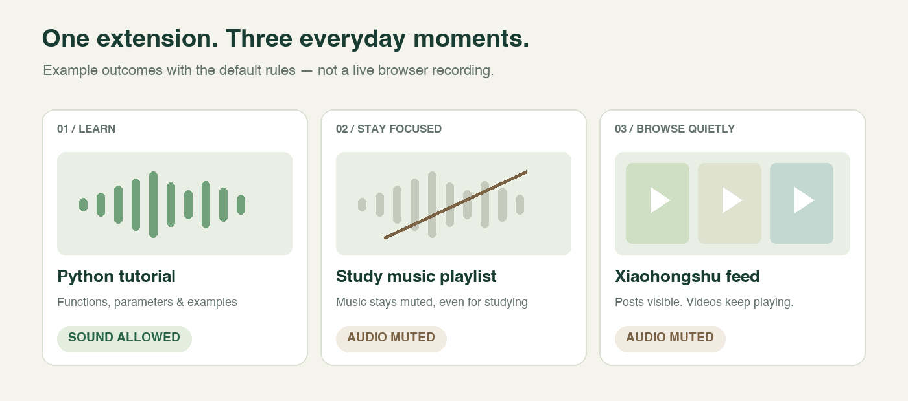
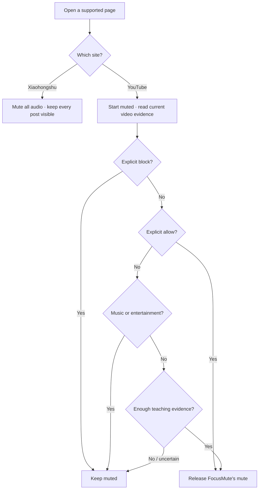

<p align="center"></p>

<p align="center"><strong>A small Chrome extension for a quieter, more intentional browser.</strong><br>English · <a href="README.zh-CN.md">简体中文</a> · <a href="LICENSE">MIT License</a> · <a href="PRIVACY.md">Privacy</a></p>

FocusMute allows sound for **likely educational YouTube videos** and keeps **Xiaohongshu / 小红书 muted without hiding posts**. One extension, two simple behaviors. No account, API key, subscription or cloud classifier.

## See it in action



_Illustrations show example outcomes with the default rules, not recordings of a live browser. Classification depends on the video's available metadata._

| What you open                                       | What FocusMute does                                      |
| --------------------------------------------------- | -------------------------------------------------------- |
| A Python tutorial with supporting teaching evidence | Allows sound, while respecting your own mute setting     |
| Music, gaming or entertainment on YouTube           | Keeps audio muted; the video can still play              |
| A YouTube video with missing or uncertain evidence  | Keeps audio muted until sufficient evidence is available |
| Any Xiaohongshu post, including a learning post     | Mutes audio and video; leaves the post visible           |
| Another website                                     | Leaves it alone                                          |

## Install — no build required

**Requires desktop Google Chrome 120 or newer.** FocusMute is not currently listed in the Chrome Web Store. Install it as an unpacked extension:

1. Download this repository using **Code → Download ZIP**, then extract it. Or clone it:
   ```sh
   git clone https://github.com/jkkjjj/focus-mute.git
   ```
2. Open `chrome://extensions` in Chrome and enable **Developer mode**.
3. Click **Load unpacked** and choose the **`extension` folder** inside the extracted repository. This folder contains `manifest.json`.
4. **Reload any already-open YouTube and Xiaohongshu pages.** Pin FocusMute from Chrome's extensions menu if you want quick access.

If a packaged ZIP is available under [Releases](https://github.com/jkkjjj/focus-mute/releases), download `focus-mute-VERSION.zip`, extract it, and select the extracted folder containing `manifest.json`. You don't need Node.js or Python to install either version. Keep that folder in a permanent location.

These steps follow Chrome's [official unpacked-extension installation guide](https://developer.chrome.com/docs/extensions/get-started/tutorial/hello-world#load-unpacked).

## Use it

- **YouTube:** videos start muted. Local rules check the current title, channel, description and available captions. When evidence supports instructional content, FocusMute releases its mute. Switching videos triggers a fresh check.
- **Xiaohongshu:** browse normally, in silence. FocusMute does not classify, hide, remove or pause posts.
- **Pause:** click the extension icon → **Pause FocusMute**. Resume from the same button. Pause restores mute settings controlled by FocusMute; it does not force sound on if you had already muted it.
- **Adjust mistakes:** open **Settings → Advanced YouTube rules**. Add video/channel IDs to allow or block lists, or edit the patterns. Explicit blocks take priority over allows. Save, undo the previous save, or export your rules.

English and Chinese patterns are included. The interface is currently in English.

## How it decides



This is **inspectable, rule-based classification**, not semantic AI. A supported subject plus teaching evidence can allow sound. Entertainment signals and explicit blocks take precedence over automatic teaching matches. Missing metadata or unavailable player controls keep audio muted. Your own mute setting is preserved.

## Privacy and permissions

All decisions happen in your browser. No analytics, external classification service, account or API key. When available, FocusMute may request captions from the **current video's YouTube caption URL**; “local classification” does not mean offline video access. [Read the privacy details](PRIVACY.md).

| Permission                                               | Purpose                                                              |
| -------------------------------------------------------- | -------------------------------------------------------------------- |
| Access to the listed YouTube and Xiaohongshu HTTPS hosts | Read current video evidence and control media on those sites         |
| `storage`                                                | Store your settings and per-tab session state locally                |
| `webNavigation`                                          | Reset decisions when navigating, including single-page video changes |

The source is plain JavaScript and Manifest V3. There are **no runtime dependencies or remote scripts**.

## Limits and troubleshooting

- This is a focus aid, not a tamper-proof website blocker. It does not block websites or other browsers, and site changes can affect detection.
- Rules can mute a useful video or allow a distracting one. Use overrides or pause when needed. No accuracy percentage or zero-audio-leak guarantee is claimed.
- Coverage is for the listed **HTTPS desktop-browser sites**, including `m.youtube.com` when opened in desktop Chrome. Native mobile apps, other domains, third-party embeds and incognito mode are outside the tested scope.
- **Nothing happens?** Check that FocusMute is enabled and allowed to run on both sites, then reload the site tab. Installation and extension updates require reloading already-open pages.
- **Learning video still silent?** Check the displayed reason, your system/player/tab volume, and other muting extensions. FocusMute never overrides a mute you deliberately kept.
- **Using an older personal version?** Pause or disable it before testing this public version so the two copies don't compete. Rules and pause state are not automatically migrated between extension IDs.
- **Update:** replace the files in the same permanent folder (or `git pull`), click the extension's reload button at `chrome://extensions`, then reload the affected site tabs. Keep the same folder to retain the extension identity and local settings.
- **Remove:** pause FocusMute first, remove it at `chrome://extensions`, then reload the affected site tabs to clear injected page scripts.

## Develop and contribute

Node.js 22+ runs the checks; Python 3 is additionally needed to create the ZIP. No `npm install` is required.

```sh
npm test          # Rules, worker, navigation and media-control regression tests
npm run check    # Manifest, permissions, source syntax and packaged references
npm run package  # Verified ZIP + SHA-256 checksum in dist/
```

Tests use controlled Chrome API and media fixtures. They do not replace real-browser checks after a website changes. See [CONTRIBUTING.md](CONTRIBUTING.md) for the browser checklist and project structure, and [the release guide](docs/releasing.md) for publishing a ZIP or preparing a Web Store submission.

Ideas and bug reports are welcome in [Issues](https://github.com/jkkjjj/focus-mute/issues). Please omit private browsing data from diagnostics.

## License

[MIT](LICENSE). Independent project; not affiliated with YouTube, Google or Xiaohongshu.
