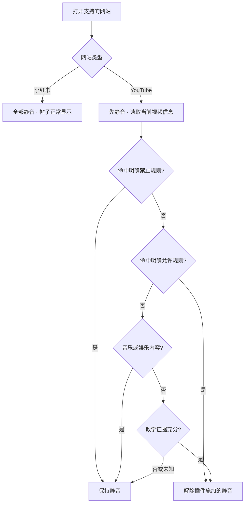

<p align="center"><strong>一个插件，两种静音方式。</strong><br><a href="README.md">English</a> · 简体中文 · <a href="LICENSE">MIT 开源</a> · <a href="PRIVACY.md">隐私说明</a></p>

**YouTube：识别到教学证据时允许声音，其余保持静音。小红书：全部静音，所有帖子正常显示。** 不需要账号、API Key、订阅或云端分类服务。

## 效果示例


_上图是默认规则的行为示意，不是真实浏览器录屏。实际结果取决于视频提供的标题、频道、简介及可用字幕。_

| 场景                                    | 预期行为                                   |
| --------------------------------------- | ------------------------------------------ |
| Python 教程，有明确教学证据             | 允许声音；尊重你原本的静音设置             |
| 音乐、游戏、娱乐视频                    | 静音，视频仍可以播放                       |
| 信息不完整、暂时判断不了的 YouTube 视频 | 保持静音                                   |
| 任意小红书帖子，包括学习内容            | 音视频全部静音；不隐藏、不删除、不暂停帖子 |
| 其他网站                                | 不处理                                     |

## 安装：不用编译

需要 **桌面版 Google Chrome 120 或更新版本**。目前尚未上架 Chrome 应用商店，采用 Chrome 官方支持的“加载已解压的扩展程序”安装方式。

1. 点击仓库的 **Code → Download ZIP** 并解压，或运行：
   ```sh
   git clone https://github.com/jkkjjj/focus-mute.git
   ```
2. 在 Chrome 地址栏打开 `chrome://extensions`，开启右上角的**开发者模式**。
3. 点击**加载已解压的扩展程序**，选择仓库内的 **`extension` 文件夹**，不是仓库最外层。选中的目录里应有 `manifest.json`。
4. **刷新已经打开的 YouTube 和小红书标签页**。可以在 Chrome 扩展菜单中固定 FocusMute，方便暂停和打开设置。

如果 [Releases](https://github.com/jkkjjj/focus-mute/releases) 中已有 `focus-mute-VERSION.zip`，下载解压后直接选择包含 `manifest.json` 的解压目录即可。普通用户不需要安装 Node.js 或 Python。请把扩展放在长期保留的位置，不要安装后删除文件夹。

参考：[Chrome 官方安装说明](https://developer.chrome.com/docs/extensions/get-started/tutorial/hello-world#load-unpacked)。

## 日常使用

- **YouTube**：先静音，读取当前视频的教学证据后决定是否允许声音。切换视频会重新判断，上一条视频的结果不会直接沿用。
- **小红书**：始终静音，但不做内容过滤，也不会出现“专注模式已过滤”的遮挡。
- **暂时关闭**：点击插件 → **Pause FocusMute**。点击 **Resume FocusMute** 恢复。暂停会恢复由插件接管的静音状态；你原本主动静音的内容不会被强行打开声音。
- **调整误判**：进入 **Settings → Advanced YouTube rules**，可填写视频或频道 ID 的允许／禁止列表，也可以编辑正则表达式。明确禁止优先于允许；支持保存、撤销上一次保存和导出 JSON。

内置规则支持中英文关键词；当前插件界面为英文。

## 判断流程



这是**本地规则判断，不是语义 AI**。规则综合主题、教学表达及辅助信息；不能保证每个学习视频都识别正确。播放器控制未就绪或信息不足时，默认保持静音。

## 隐私与权限

不接入分析统计或外部分类服务。设置保存在浏览器本地，分类也在本地完成；如果当前 YouTube 视频有可用字幕，插件可能向该视频的 YouTube 字幕地址发起请求。完整细节见 [PRIVACY.md](PRIVACY.md)。

| 权限                                      | 用途                               |
| ----------------------------------------- | ---------------------------------- |
| 列出的 YouTube、小红书 HTTPS 站点访问权限 | 读取当前视频信息、控制媒体         |
| `storage`                                 | 保存设置和标签页临时状态           |
| `webNavigation`                           | 在普通导航和站内切换时重新应用规则 |

采用 Manifest V3 和普通 JavaScript，没有运行时第三方依赖或远程脚本。

## 常见问题

- **完全没效果**：确认扩展已启用、站点访问权限允许它在对应网站运行，然后刷新网站标签页。安装和更新后，原来打开的页面需要刷新。
- **学习视频仍没声音**：查看提示原因，并检查播放器、标签页、系统音量及其他静音插件。可以添加允许规则或暂时暂停。
- **已经装过个人版**：测试公开版前暂停或停用旧版，避免两个插件同时控制声音。不同扩展 ID 之间不会自动迁移设置。
- **更新**：在原目录覆盖新版文件，或使用 `git pull`；在扩展页面点重新加载，再刷新网站。保留相同路径，以保留扩展身份和设置。
- **卸载**：建议先暂停，再到扩展页面移除，并刷新相关网站以清除注入的页面脚本。

这是辅助专注的工具，不是不可绕过的访问限制。公开版不包含网站屏蔽功能，不控制其他浏览器。网站改版可能影响识别；不承诺百分之百准确或绝对没有短暂声音。覆盖范围是列出的 HTTPS 桌面浏览器站点；手机 App、其他域名、第三方网页内嵌播放器和无痕窗口不在已测试范围内。

## 开发

检查需要 Node.js 22+；打包另外需要 Python 3。无需运行 `npm install`。

```sh
npm test
npm run check
npm run package
```

安装包和 SHA-256 校验文件生成在 `dist/`。自动化测试使用模拟的 Chrome API 和媒体环境，不能替代真实网站回归。详见 [贡献指南](CONTRIBUTING.md) 和 [发布说明](docs/releasing.md)。

欢迎提交 [Issue](https://github.com/jkkjjj/focus-mute/issues)。分享诊断信息前，请去掉个人浏览数据。

## 许可证

[MIT](LICENSE)。独立项目，与 YouTube、Google 或小红书无隶属关系。
